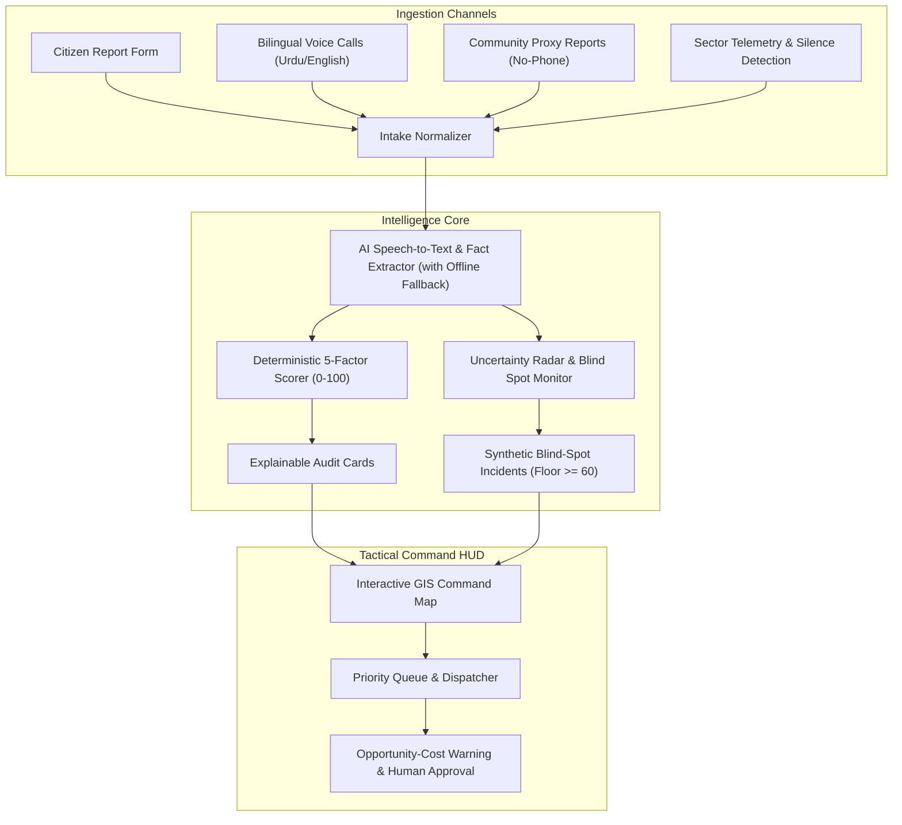

# Nigehbaan (نگہبان)

> **"Nigehbaan finds the people the system can't hear."**  
> Tactical Disaster Triage & Emergency Coordination Platform for Flood Emergencies.  
> *Clear priorities. Coordinated response. Leaving no one invisible.*

---

## 📌 Executive Summary

During catastrophic floods, emergency warnings rarely reach the most vulnerable—elderly residents living alone, informal settlements (*katchi abadis*), people with disabilities or chronic illnesses, and those whose cell towers have washed away. Standard disaster software only prioritizes who shouts loudest on social media or direct phone calls.

**Nigehbaan (نگہبان --- "The Guardian")** addresses **Problem 01: Finding who needs help most** by delivering a high-reliability, explainable tactical command platform that turns scattered reports, community proxy reports, and total communication dropouts into auditable triage priorities and smart resource assignments.

---

## 🚀 Core Innovations

### 1. The Uncertainty Radar & Blind-Spot Synthesis (Core Differentiator)
- **Decouples Urgency from Confidence:** Missing information never penalizes a victim; missing factor weights are renormalized while raising an explicit review flag.
- **Data Black Hole Detection:** When a monitored hazard sector exhibits complete radio/cell silence during rising floodwaters, Nigehbaan detects a `coverage_blind_spot` and automatically synthesizes a high-priority incident (enforced **score $\ge 60$**) labeled **"Physical Welfare Recon / Field Sweep"**.

### 2. Explainable Deterministic Triage (0–100 Scale)
- Scores are strictly computed by deterministic TypeScript math, **never by an LLM**:
  $$\text{Score} = 100 \times \sum_{i=1}^5 \left(w_i \cdot \frac{\text{factor}_i}{5}\right)$$
  *(Weights: Life Threat 0.30, Medical Urgency 0.25, Evacuation Inability 0.20, Environmental Danger 0.15, Population 0.10)*
- Priority Categories: **Critical ($\ge 75$)**, **High ($55 - 74.9$)**, **Moderate ($35 - 54.9$)**, **Low ($< 35$)**.
- Each incident displays a transparent **Explainability Rationale Card**.

### 3. Smart Resource Allocation with Opportunity Cost
- Evaluates asset terrain compatibility (shallow jet-boats vs. 4x4s) and destination shelter capacities.
- Computes deterministic **Opportunity Cost Warnings** before approval (*"Assigning Shallow Jet-Boat 01 to NG-101 leaves 0 shallow-draft assets in Sector 2; Incident NG-104 [Score 56.5 — High] will incur an estimated +35 min delay"*).
- Requires explicit **Human Coordinator Approval** (no autonomous dispatch).

### 4. Multi-Phase Disaster Timeline Scrubber
- Allows operators and evaluators to scrub through disaster progression: `T-0 Early Warning`, `T+3 Flood Surge`, `T+6 Grid Blackout`, and `T+12 Peak Crisis`.
- Synchronizes environmental gauges (0.6m to 2.4m), infrastructure alerts (`Tower-Alpha-3` collapse, `SHL-03` blackout), and blind-spot detection.

### 5. Capability-Based Medical Shelter Routing (Tier 2)
- Evaluates destination shelters based on live capabilities (e.g., dialysis power units, surgical capacity).
- Routes dialysis patients (`NG-101`) specifically to `SHL-02` (District Civil Hospital Annexe).
- Automatically excludes facilities with power failure or capacity breach (`SHL-03` at 97% capacity and offline generator).

### 6. Bilingual Voice Distress Hotline with Web Audio Waveform (Tier 2)
- Real-time HTML5 Canvas Web Audio API visualizer displaying live audio waveform frequencies.
- Interactive playback controls (scrubbing, timestamp, mute, replay).
- Synchronized bilingual transcript card displaying spoken Urdu in `dir="rtl"` alongside English translation in `dir="ltr"` with honest provenance badge: `"Scripted transcript for simulated call"`.

### 7. Installable PWA with Resilient Offline Queue (Tier 2)
- PWA manifest and service worker shell caching.
- Intercepts report submissions when offline (`navigator.onLine === false`), performing client-side heuristic extraction and persisting in `localStorage`.
- Displays confirmation banner: `"Report queued locally (offline mode)"` and automatically drains and syncs to the live command dashboard upon reconnect.

### 8. "FCFS vs. Nigehbaan" Retrospective Impact Panel (Tier 2)
- Compares naive arrival-order triage (First-Come First-Served) against Nigehbaan Multi-Criteria Triage at $T+12$ Peak Crisis:
  - **Critical Dispatch Latency:** Reduced by **97%** (from 212 min to 7 min).
  - **Fleet Misallocation:** Reduced from 40% to **0%**.
  - **Silent Blackout Recon:** **100% coverage** under Nigehbaan vs **0%** under FCFS (which completely abandons silent Sector 3A).
  - **Preventable Casualties:** Reduced from 4 to **0**.

---

## 🛠️ Architecture & Tech Stack

- **Frontend & App:** Next.js 14/15 App Router, TypeScript (Strict), Tailwind CSS (`DESIGN.md` crisis tokens), Lucide Icons, Leaflet GIS.
- **Client State & Persistence:** Reactive client-side store (Zustand) with `localStorage` persistence and instant 1-click baseline reset. All business logic engines are pure TypeScript in `src/lib/`.
- **Stateless AI Helpers:** Serverless routes calling Google Gemini API (`@google/genai`) for structured extraction and speech-to-text, paired with explicit offline heuristic fallbacks.
- **Offline / PWA:** Service Worker shell pre-caching + LocalStorage Offline Queue with reconnect sync.
- **Testing Infrastructure:** Vitest with **139/139 automated tests passing across 13 test suites (100% pass rate)**.
- **Deployment:** Vercel (Edge/Serverless).

---

## 📂 Documentation & Specification Index

- **[`AGENTS.md`](./AGENTS.md)** --- AI coding contract, tier definitions, and safety rules
- **[`DESIGN.md`](./DESIGN.md)** --- Crisis design tokens, WCAG AA contrast standards, and UI components
- **[`docs/PRD.md`](./docs/PRD.md)** --- Product Requirements Document with Tier 1/2/3 scope matrix
- **[`docs/scoring-spec.md`](./docs/scoring-spec.md)** --- Deterministic triage formula, lookup tables, and worked examples
- **[`docs/seed-data.md`](./docs/seed-data.md)** --- District Alpha dataset, sectors, resources, and timeline event logs
- **[`docs/acceptance-tests.md`](./docs/acceptance-tests.md)** --- Given/When/Then test criteria for every feature
- **[`docs/ai-prompts.md`](./docs/ai-prompts.md)** --- Exact Gemini extraction, audio transcription, and rationale prompts
- **[`docs/architecture.md`](./docs/architecture.md)** --- Data flow, client-store architecture, and offline PWA design
- **[`docs/trade-offs.md`](./docs/trade-offs.md)** --- Technical decisions: what was chosen, what was cut, and why
- **[`docs/rules.md`](./docs/rules.md)** --- Engineering standards, safety boundaries, and tier milestones
- **[`docs/demo-script.md`](./docs/demo-script.md)** --- 3-minute evaluation script, 90-second pitch, and fallback guide
- **[`docs/submission-checklist.md`](./docs/submission-checklist.md)** --- Pre-submission compliance and deadline checklist
- **[`docs/memory.md`](./docs/memory.md)** --- Living project state, active decisions, and session changelog

---

## 👥 Submission & Team Details

- **Event:** CODE//CONNECT'26 --- 36-Hour Vibe Coding Hackathon
- **Problem Statement:** Problem 01 --- Disaster Response & Emergency Coordination
- **Team Name:** `Byte Alpha's`
- **Members:**
  1. **Syed Ali Hashmi** (Team Leader) --- Roll No: `EB-24210106108` | 3rd Year BSSE (UBIT)
  2. **Syed Umer Hashmi** --- Roll No: `EB-25210006105` | 2nd Year BSCS (UBIT)
- **Live Demo Link:** [https://nigehbaan.vercel.app](https://nigehbaan.vercel.app)
- **3-Minute Video Walkthrough:** [https://youtu.be/nigehbaan-demo](https://youtu.be/nigehbaan-demo)
- **GitHub Repository:** [https://github.com/alihashmi2288/Nigehbaan.git](https://github.com/alihashmi2288/Nigehbaan.git)
- **AI Policy Notice:** AI-tool policy compliance to be confirmed with event organizers.

---

## 🤖 AI Usage Disclosure

In compliance with hackathon regulations:
- **Pair-Programming & Architecture:** Built with **Antigravity IDE** for documentation structuring, TypeScript typing, and Next.js component scaffolding.
- **Runtime AI:** Google Gemini API (`@google/genai`) is used strictly for structured fact extraction, bilingual speech-to-text, and natural-language rationale cards. When offline or without an API key, the system transparently labels outputs as *"Offline heuristic extraction (not AI)"* or *"Scripted transcript for simulated call"*.
- **Deterministic Invariant:** All priority scoring (0–100), uncertainty flags, blind-spot floors, and opportunity cost calculations are **100% deterministic TypeScript logic**. The LLM never computes scores or dispatches assets.

---

## 🧪 Quick 3-Minute Demo Flow for Evaluators

1. **Dashboard & Map (T-0):** View District Alpha situational overview with active incidents and resource markers (`SIMULATED DATA`).
2. **Deterministic Triage & Explanation (T+3):** Advance scrubber to T+3; open Incident NG-101 (Dialysis, Score 86.5, Critical) and inspect transparent factor contribution breakdown card.
3. **Opportunity Cost Warning & Capability Shelter Matching:** Click "Assign Resource" -> select Shallow Jet-Boat 01 -> review explicit warning (*leaves 0 boats in Sector 2; +35 min delay for NG-104*) -> review matched shelter (`SHL-02` Dialysis Ready) -> approve assignment.
4. **Blind-Spot Synthesis & Uncertainty Radar (T+6):** Advance scrubber to T+6; observe Tower-Alpha-3 collapse and the Uncertainty Radar triggering synthetic Incident NG-103 (Score 68.7, High) for silent Sector 3A. View side-by-side conflicting bridge reports NG-108/NG-109 without auto-merging.
5. **Bilingual Voice Hotline:** Open Voice Hotline; play simulated Urdu distress call (`CALL-NG102`); observe real-time Web Audio waveform and synchronized Urdu RTL / English translation with honest badge.
6. **FCFS vs. Nigehbaan Retrospective (T+12):** Advance timeline to T+12; open FCFS Analysis modal to inspect 97% latency reduction and 4 casualties prevented over naive arrival queue.
7. **Scenario Reset:** Click "Reset Simulation" to instantly restore pristine baseline state in `localStorage` in <10ms.
