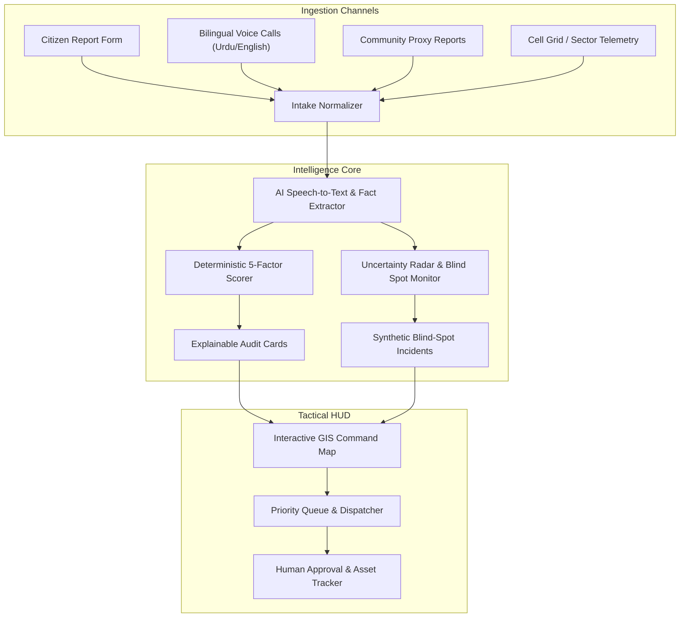

# Nigehbaan (نگہبان)

> **AI-Assisted Tactical Disaster Triage & Emergency Coordination Platform**  
> *Clear priorities. Coordinated response. Leaving no one invisible.*

[](https://nextjs.org/)
[](https://www.typescriptlang.org/)
[](https://tailwindcss.com/)
[](https://leafletjs.com/)
[](https://vercel.com/)
[](https://github.com)

---

## 📌 Executive Summary

During catastrophic floods, heatwaves, and monsoons, emergency warnings rarely reach the most vulnerable—elderly residents living alone, low-income informal settlements (*katchi abadis*), people with disabilities or chronic illnesses, and those without smartphones or cellular signal. Meanwhile, rescue teams, shallow-draft boats, 4x4 vehicles, and medical supplies are strictly finite.

**Nigehbaan (نگہبان --- "The Guardian")** addresses **Problem 01: Finding who needs help most** by delivering a high-reliability, explainable tactical command platform that turns scattered reports and communication dropouts into auditable triage priorities and smart resource assignments.

---

## 🚀 Key Innovations



### 1. Pre-Disaster Vulnerability Baseline & T-0 Proactive Pre-Positioning
- **Acting Before the Crisis:** Leverages simulated community health baselines (Lady Health Worker logs, chronic dialysis lists, low-lying informal settlements / *katchi abadis*) to identify who is most at risk *before* distress calls begin.
- **Proactive Staging at T-0:** When early hydrological surge forecasts trigger at `T-0`, Nigehbaan recommends pre-positioning shallow-draft jet-boats and mobile clinics at high-ground staging depots near Sector 3A before road access is submerged at `T+3`.

### 2. The Uncertainty Radar & "Data Black Hole" Detection
- Decouples **urgency** from **information confidence**.
- Actively detects missing locations, stale claims (>60m), contradictory road reports, and potential duplicates (flagged, never auto-merged).
- **Sector-to-Incident Synthesis:** When a high-hazard sector exhibits zero communications during rising floodwaters, Nigehbaan flags a `coverage_blind_spot` and automatically synthesizes an incident with an enforced **$4.0 / 5.0$ vulnerability floor**, routing it into the dispatch queue for an immediate **Physical Welfare Recon / Field Sweep**.

### 3. Bilingual Voice & Audio Distress Ingestion
- Accommodates low-literacy and panicking citizens through a simulated **Urdu/English Voice Hotline**.
- Features an interactive audio waveform visualizer, real-time speech-to-text transcription, and automated entity extraction with complete data provenance.

### 4. Explainable Deterministic Triage
- Uses an audited Multi-Criteria Decision Analysis (MCDA) mathematical formula:
  $$V = 0.30 \cdot \text{LifeThreat} + 0.25 \cdot \text{MedicalUrgency} + 0.20 \cdot \text{EvacuationInability} + 0.15 \cdot \text{EnvironmentalDanger} + 0.10 \cdot \text{Population}$$
- Accompanied by **Explainability Rationale Cards** providing human-auditable justifications for commanders.

### 5. Smart Resource Allocation with Opportunity Cost & Shelter Matching
- **Two-Stage Matching:** 
  1. **Asset-to-Incident:** Matches specialized vehicles (shallow jet-boats, heavy 4x4s, mobile medical units) to terrain obstacles and medical urgency.
  2. **Incident-to-Shelter:** Dynamically routes evacuees to relief camps or field hospitals based on real-time bed capacity, backup generator status, and specialized medical capabilities (e.g. dialysis support), auto-filtering shelters that exceed 95% occupancy or suffer power blackouts.
- **Deterministic Opportunity Cost Warning:** Displays explicit trade-off consequences before approval (*"Assigning Shallow Jet-Boat 01 to Incident #1 leaves 0 shallow-draft assets in Sector 3; Incident #4 [Score 3.9] will incur an estimated +35 min delay"*).
- Strictly enforces human-in-the-loop authorization before marking any asset dispatched.

### 6. Multi-Phase Disaster Timeline Scrubber
- Allows operators and hackathon evaluators to scrub through disaster progression:
  - `T-0 Early Warning` (Hydrological forecast overlay & proactive asset pre-positioning)
  - `T+3 Flood Surge` (Inundation of low-lying settlements, cut roads)
  - `T+6 Grid Blackout` (Cell towers drop, Uncertainty Radar triggers blind spot escalations)
  - `T+12 Peak Crisis` (Exhaustion of shallow boats, acute opportunity cost trade-offs)

---

## 🛠️ Tech Stack & Architecture

- **Frontend & Fullstack:** Next.js (App Router), React, TypeScript
- **Styling & UI:** Tailwind CSS, high-density operational crisis tokens ([`DESIGN.md`](./DESIGN.md)), Lucide icons
- **Mapping:** Leaflet, React-Leaflet (CartoDB tiles)
- **AI & Audio:** Google Gemini API (`@google/genai`), Web Audio API
- **Deployment:** Vercel (Edge & Serverless API Routes)
- **Reliability:** Zero-dependency in-memory reactive repository pre-warmed with Sindh monsoon flood scenario telemetry for 100% reliable Vercel uptime.

---

## 📂 Documentation & Architecture Guide

The project specifications and governance documents are organized as follows:

- **[`DESIGN.md`](./DESIGN.md)** (Root) --- Authoritative Operational Crisis Design System, Color Tokens & Component Guidelines
- **[`AGENTS.md`](./AGENTS.md)** (Root) --- AI Agent Coding Contract, Safety Boundaries & Reading Sequence
- **[`docs/PRD.md`](./docs/PRD.md)** --- Complete Product Requirements Document & Acceptance Criteria
- **[`docs/architecture.md`](./docs/architecture.md)** --- System Architecture, Data Models, Routes & Service Boundaries
- **[`docs/trade-offs.md`](./docs/trade-offs.md)** --- Architectural, AI, Data & UX Trade-offs: What we chose, what we left out, and why
- **[`docs/rules.md`](./docs/rules.md)** --- Engineering Rules, AI Safety Boundaries & Phase Plan
- **[`docs/memory.md`](./docs/memory.md)** --- Living State & Project Handoff Tracker

---

## 👥 Official Submission & Team Details (Section 05 Compliance)

- **Event:** CODE//CONNECT'26 --- 36-Hour Vibe Coding Hackathon
- **Problem Statement:** Problem 01 --- Disaster Response & Emergency Coordination ("Finding who needs help most")
- **Team Name:** `Byte Alpha's`
- **Registered Members:**
  1. **Syed Ali Hashmi** (Team Leader) --- Roll No: `EB-24210106108` | 3rd Year BSSE (UBIT)
  2. **Syed Umer Hashmi** --- 2nd Year BSCS
- **Live Demo Link:** `https://nigehbaan.vercel.app` *(or team custom Vercel deployment URL)*
- **GitHub Repository:** `https://github.com/alihashmi2288/Nigehbaan.git`

---

## 🤖 AI Usage Disclosure (Sections 03 & 05 Compliance)

In accordance with the CODE//CONNECT'26 AI-tools policy:
- **Assisted Coding & Architecture:** Built pair-programming with **Antigravity IDE** for architecture scaffolding, Next.js App Router implementation, TypeScript types, and verification test suites.
- **Runtime Intelligence:** Live structured fact extraction, bilingual Urdu/English speech transcription, and natural-language explainability rationale are processed via the **Google Gemini API** (`@google/genai`) with pre-warmed heuristic fallback for zero-downtime resilience.
- **Safety Governance:** All priority scoring, uncertainty detection algorithms, opportunity cost calculations, and resource compatibility checks are **100% deterministic TypeScript application code**. The LLM never makes autonomous dispatch decisions or calculates priority scores directly.

---

## ⚡ Quickstart & Local Setup

```bash
# 1. Clone the repository
git clone https://github.com/alihashmi2288/Nigehbaan.git

# 2. Enter project directory
cd Nigehbaan

# 3. Install dependencies
npm install

# 4. (Optional) Configure Gemini API key for live LLM extraction
cp .env.example .env.local
# Set GEMINI_API_KEY="your_api_key" (system automatically uses realistic fallback if omitted)

# 5. Start local development server
npm run dev

# 6. Open in browser
# http://localhost:3000
```

---

## 🧪 Quick 3-Minute Demo Walkthrough for Evaluators

1. **Dashboard Overview:** Load the application to view the active situational picture in District Alpha (`SIMULATED DATA`).
2. **T-0 Pre-Disaster Baseline:** At `T-0 Early Warning`, review the pre-disaster vulnerability registry (isolated elderly, chronic illness registry) and see the proactive staging recommendation for Shallow Jet-Boat 01 near Sector 3A.
3. **Uncertainty Radar:** Inspect the **Sector 3A (Riverbank)** dead-zone flag at `T+6`; observe how 90 minutes of silence synthesized a `system_blind_spot` incident with an enforced $4.0/5.0$ vulnerability floor.
4. **Voice Hotline:** Open the **Distress Simulator**, play the simulated Urdu emergency call, watch the waveform, and click **"Transcribe & Extract"**.
5. **Explainable Triage & Opportunity Cost:** Open Incident #1 (Critical - Dialysis Patient), review the factor breakdown card, click **"Assign Resource"**, review the **Opportunity Cost Trade-Off Warning** and matched destination shelter (equipped with dialysis backup), and click **"Approve"**.
6. **Timeline Scrubbing:** Scrub through `T-0`, `T+3`, `T+6`, and `T+12` on the timeline bar to watch water levels rise, shelter capacities fill, and cell towers drop dynamically.

---

## ⚖️ Safety & Ethical Disclaimer

Nigehbaan is an **AI-assisted decision-support prototype** for demonstration and hackathon evaluation. All scenario data, map coordinates, and audio calls are fictional and clearly labelled as simulated. The system is designed to augment human coordinators and does not claim to execute real-world emergency dispatches or clinical medical diagnoses.
