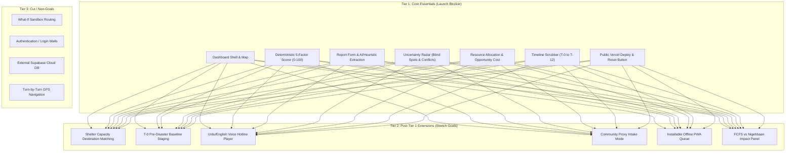

# Nigehbaan --- Product Requirements Document (PRD)

**Project:** Nigehbaan (نگہبان)  
**Event:** CODE//CONNECT'26 --- Vibe Coding Hackathon  
**Problem Statement:** Problem 01 --- Disaster Response & Emergency Coordination  
**Document Status:** Planned / Target MVP Specification  
**Version:** 2.0 (Tiered Architecture Alignment)  
**Primary Tagline:** *"Nigehbaan finds the people the system can't hear."*  

---

## 1. Executive Summary

During catastrophic floods, emergency warnings rarely reach the most vulnerable—elderly residents living alone, low-income informal settlements (*katchi abadis*), people with disabilities or chronic illnesses, and those whose cellular infrastructure has collapsed. Standard disaster systems only prioritize citizens who shout the loudest with smartphones.

**Nigehbaan** is an AI-assisted tactical disaster triage and coordination decision-support platform. It turns scattered citizen reports, community proxy submissions, and total communication dropouts into auditable triage priorities (0–100 deterministic scale) and actionable resource assignments with explicit opportunity cost warnings.

Nigehbaan is an **operational decision-support prototype**, not an autonomous dispatch system. Consequential resource assignments always require explicit human coordinator approval.

---

## 2. Problem Statement

In flood disasters (e.g. Sindh/Indus monsoon surges):
1. **Information Incompleteness & Blackouts:** Reports are fragmented, delayed, and contradictory. Monitored sectors that go completely silent are often in the greatest danger, but traditional queues ignore them because no tickets are submitted.
2. **Subjective & Opaque Triage:** Manual dispatchers get overwhelmed, defaulting to First-Come, First-Served (FCFS) or gut instinct, stranding high-vulnerability victims.
3. **Hidden Opportunity Costs:** Dispatching a specialized shallow-draft boat to a low-urgency area depletes the sector, stranding dying patients in subsequent calls without the dispatcher realizing the delay penalty.
4. **Shelter Mismatch:** Evacuees with acute needs (e.g., dialysis, oxygen) are sent to overcrowded shelters lacking generator power or medical facilities.

---

## 3. Product Vision & Differentiator

### Core Promise
> Turn incomplete emergency reports and communication blackouts into explainable priorities and auditable resource allocations.

### Core Differentiator: The Uncertainty Radar & Blind-Spot Synthesis
Nigehbaan decouples **urgency** from **information confidence**. When a high-hazard sector exhibits zero incoming communications during rising floodwaters, Nigehbaan flags a `coverage_blind_spot` and automatically synthesizes a high-priority incident (score $\ge 60$) for an immediate **Physical Welfare Recon / Field Sweep**.

---

## 4. Target Users & Stakeholders

1. **Primary: Emergency Coordination Officer:** Needs a consolidated operational picture to compare incident urgency, inspect uncertainty flags, and allocate scarce assets with clear trade-off visibility.
2. **Secondary: Citizen / Community Proxy Reporter:** Needs a simple web form to report emergencies for themselves or for vulnerable neighbors who lack phones or connectivity.
3. **Tertiary: Shelter & Relief Manager (Tier 2):** Needs visibility into inbound evacuee volume matched against live shelter bed capacity, generator backup, and medical capabilities.
4. **Evaluation Stakeholder: Hackathon Judge:** Needs to test the end-to-end workflow on Vercel, inspect the deterministic scoring math, scrub through the disaster timeline, and verify system resilience.

---

## 5. Scope & Tiered Implementation Roadmap

To guarantee a 100% reliable, zero-downtime submission before the strict hackathon deadline, all requirements are organized into three disciplined tiers.

### Tier 1: Core Essentials (Demo Fails Without It)
1. **Coordinator Operations Dashboard:** High-density split-screen layout with interactive Leaflet GIS map, prioritized incident queue, and selected incident inspector.
2. **Deterministic Triage Scorer:** Pure TypeScript 5-factor MCDA formula producing an auditable 0–100 score, accompanied by an **Explainability Rationale Card**. Supported by automated unit tests.
3. **Report Intake & Extraction:** Direct web report form with structured fact extraction (Google Gemini API) and transparent fallback (*"Offline heuristic extraction (not AI)"*).
4. **Uncertainty Radar:** Explicit flags for missing locations, stale reports (>60m), contradictory road claims, and sector coverage blind spots. Missing data renormalizes weights and never lowers priority.
5. **Smart Resource Recommendation & Opportunity Cost:** Compatibility filtering (shallow-draft boat vs. 4x4) with deterministic **Opportunity Cost Warnings** before human approval.
6. **Timeline Scrubber ($T-0, T+3, T+6, T+12$):** Interactive progression driving water levels, road cutoffs, tower blackouts, and blind-spot incident synthesis.
7. **Simulation Reset & Vercel Deployment:** 1-click reset restoring the pre-warmed `localStorage` baseline completely. Zero console errors on public Vercel deploy.

### Tier 2: Post-Tier 1 Extensions (Build ONLY after Tier 1 is verified & deployed)
1. **Shelter Capacity & Capability Destination Matching:** Dynamic routing based on shelter bed occupancy, generator status, and specialized care (dialysis/oxygen), auto-filtering shelters $>95\%$ full.
2. **Pre-Disaster Baseline & T-0 Proactive Staging:** Demographic baselines (isolated elderly, chronic illness registry, low-lying settlements) recommending proactive staging before roads flood at $T+3$.
3. **Bilingual Voice Intake (Urdu / English):** Audio distress player with waveform visualizer and dual-language transcription (Gemini speech-to-text or scripted fallback labeled *"Scripted transcript for simulated call"*).
4. **Community Proxy Intake:** Intake mode for filing on behalf of others, tracking phone access status (`has_phone`, `no_phone`, `network_down`, `unknown`).
5. **Installable PWA Form:** Offline queue with local caching and background sync for field volunteers.
6. **"FCFS vs. Nigehbaan" Baseline Comparison Panel:** Analytical summary at $T+12$ comparing standard First-Come First-Served outcomes against Nigehbaan triage.

### Tier 3: Cut / Non-Goals (Explicitly Out of Hackathon Scope)
- **Complex What-If Sandboxes:** Replaced by the clean, predictable 4-step Timeline Scrubber.
- **User Authentication / Passwords:** Unnecessary barrier for evaluators; use 1-click coordinator persona.
- **External Database (Supabase):** Replaced by reactive client-side store with `localStorage` to eliminate network connection pool limits and serverless migration downtime during judging.
- **Turn-by-Turn GPS Navigation for Boats:** Unrealistic without real bathymetric sonar sensors.
- **Arbitrary Duplicate Auto-Merging:** Risky; duplicates are flagged for human review, never silently merged or deleted.

---

## 6. Main User Journeys

### Journey A --- Submit and Process an Emergency Report *(Tier 1)*
1. Citizen or field scout opens the report form.
2. User enters unstructured description (e.g. *"Water entering house, elderly mother with heart condition, no boat"*).
3. System saves the raw text immediately.
4. Extractor parses structured entities (Life Threat: 4, Medical Urgency: 4, Mobility: 4, Location: Sector 2). If API is unavailable, system executes rule-based extraction and visibly labels it *"Offline heuristic extraction (not AI)"*.
5. Incident appears in the queue with calculated priority score (82 / 100, Critical).

### Journey B --- Review Incident Priority & Explainability *(Tier 1)*
1. Coordinator inspects the incident queue, sorted by deterministic priority score.
2. Coordinator clicks an incident to open the inspector card.
3. System presents the 5 factor scores, the mathematical formula, and a human-auditable rationale card explaining the rating.
4. Missing fields are visibly marked with confidence indicators without lowering priority.

### Journey C --- Recommend and Approve Resource with Opportunity Cost *(Tier 1)*
1. Coordinator selects an incident needing evacuation.
2. System filters available assets by terrain suitability (e.g., Shallow Jet-Boat required for flood zone).
3. Before dispatch approval, system displays an **Opportunity Cost Warning Card**: *"Assigning Shallow Jet-Boat 01 leaves 0 shallow-draft assets in Sector 3; Incident #4 [Score 78] will incur an estimated +35 min delay."*
4. Coordinator reviews the trade-off and clicks "Approve Assignment".
5. Resource status transitions to `assigned`, and an entry is written to the audit activity log.

### Journey D --- Resolve Uncertainty in Radar *(Tier 1)*
1. Uncertainty Radar highlights flags: Missing Location (Incident #3), Conflicting Road Reports (Route 4), Stale Report (>60 min), and Coverage Blind Spot.
2. Coordinator clicks a flag, reviews the conflicting reports side-by-side, and records a verification note.
3. Reports are never silently overwritten or merged.

### Journey E --- Timeline Scrubbing & Blind-Spot Escalation *(Tier 1)*
1. Coordinator scrubs the timeline from `T-0` through `T+6 Grid Blackout`.
2. Telemetry indicates Sector 3A cell towers dropped 90 minutes ago with zero incoming reports while flood levels rose to 1.8m.
3. Uncertainty Radar triggers a `coverage_blind_spot` and synthesizes an incident labeled **"Physical Welfare Recon / Field Sweep"** with a minimum score of **60 / 100 (High)**.
4. Coordinator dispatches a recon patrol directly from the queue.

### Journey F --- Shelter Capacity Destination Matching *(Tier 2)*
1. Evacuee requiring dialysis is assigned an evacuation boat.
2. System evaluates destination shelters: Shelter A (98% full - excluded), Shelter B (Grid down, generator failed - excluded), Shelter C (72% capacity, dialysis capability, backup power active - matched).
3. Coordinator approves destination routing; Shelter C occupancy increments.

### Journey G --- Bilingual Voice Distress Hotline *(Tier 2)*
1. Evaluator opens the voice hotline player and clicks play on an incoming Urdu distress call.
2. Audio visualizer renders live waveform.
3. Speech-to-text service provides Urdu transcript and English translation.
4. Extracted facts feed into the deterministic triage engine with provenance linked to audio timestamps.

### Journey H --- Pre-Disaster Vulnerability Baseline & T-0 Proactive Staging *(Tier 2)*
1. At `T-0 Early Warning`, coordinator toggles the Pre-Disaster Vulnerability Baseline (Lady Health Worker registry, chronic dialysis lists, low-lying informal settlements).
2. Hydrological surge model predicts inundation of Sector 3A at `T+3`.
3. System suggests proactive pre-positioning of Shallow Jet-Boat 01 at High Ground Staging Depot Alpha before arterial access roads submerge.

---

## 7. Functional Requirements Matrix

| ID | Feature Description | Tier | Acceptance Criteria |
| :--- | :--- | :---: | :--- |
| **FR-01** | Raw Report Ingestion | **Tier 1** | Captures raw report text, timestamp, and reporter type. Original text is never altered. |
| **FR-02** | Structured Fact Extraction | **Tier 1** | Extracts structured fields via Gemini; falls back gracefully to rule-based parser on failure. |
| **FR-03** | Honest Fallback Labeling | **Tier 1** | Visibly tags fallback outputs as *"Offline heuristic extraction (not AI)"*. |
| **FR-04** | Deterministic 5-Factor Scoring | **Tier 1** | Implements exact MCDA formula yielding 0–100 score; identical inputs produce identical scores. |
| **FR-05** | Explainability Rationale Cards | **Tier 1** | Displays transparent breakdown of factor contributions and natural-language justification. |
| **FR-06** | Incident Queue & Filtering | **Tier 1** | Renders sorted queue with status badges, priority categories (Critical/High/Moderate/Low), and sector filters. |
| **FR-07** | Interactive GIS Command Map | **Tier 1** | Renders Leaflet map with incident markers, resource locations, and sector boundary overlays. |
| **FR-08** | Resource Recommendation & Compatibility | **Tier 1** | Matches vehicles by terrain suitability; excludes already-assigned assets. |
| **FR-09** | Opportunity Cost Warning | **Tier 1** | Computes and displays sector asset depletion and queue delay penalties before dispatch. |
| **FR-10** | Human Dispatch Approval | **Tier 1** | Strictly requires coordinator confirmation before assigning an asset; records action in audit log. |
| **FR-11** | Uncertainty Radar: Missing & Stale | **Tier 1** | Flags missing location and stale reports (>60 min); separates confidence from urgency. |
| **FR-12** | Uncertainty Radar: Conflicts & Duplicates | **Tier 1** | Flags conflicting road claims and potential duplicate reports without silent merging. |
| **FR-13** | Uncertainty Radar: Blind-Spot Synthesis | **Tier 1** | Synthesizes a `system_blind_spot` incident (Score $\ge 60$, High) when a sector goes dark. |
| **FR-14** | Timeline Scrubber ($T-0 \to T+12$) | **Tier 1** | Controls 4 discrete scenario stages, updating water levels, closures, and tower telemetry. |
| **FR-15** | 1-Click Simulation Reset | **Tier 1** | Restores seed data baseline in `localStorage` instantaneously. |
| **FR-16** | Zero-Downtime Public Deployment | **Tier 1** | App builds cleanly and runs on public Vercel URL with no cold-start blockers. |
| **FR-17** | Shelter Capacity Destination Matching | **Tier 2** | Evaluates bed capacity, power status, and clinical capabilities; auto-filters shelters $>95\%$ full. |
| **FR-18** | T-0 Pre-Disaster Baseline Staging | **Tier 2** | Overlays static demographic vulnerability data at $T-0$ to recommend proactive staging. |
| **FR-19** | Bilingual Voice Distress Hotline | **Tier 2** | Plays simulated audio, renders waveform, and displays Urdu/English transcription. |
| **FR-20** | Community Proxy Intake Mode | **Tier 2** | Allows reporting on behalf of others; tracks phone access (`has_phone`, `no_phone`, `network_down`). |
| **FR-21** | Installable PWA with Offline Queue | **Tier 2** | Caches shell and queues offline report submissions for background sync. |
| **FR-22** | FCFS vs. Nigehbaan Impact Panel | **Tier 2** | Displays simulated comparative metrics on $T+12$ screen showing lives saved vs. FCFS. |

---

## 8. Deterministic Priority Model Specification

Priority scoring is governed by a transparent, multi-criteria mathematical formula. For complete lookup tables, factor bucket definitions, and worked examples, see **[`docs/scoring-spec.md`](./scoring-spec.md)**.

### Mathematical Formula
$$\text{Priority Score} = 100 \times \sum_{i=1}^5 \left(w_i \cdot \frac{\text{factor}_i}{5}\right)$$

### Factor Weights & Scale (0–5 per factor)
1. **Immediate Threat to Life ($w_1 = 0.30$):** Active drowning, roof collapse, swept away, chest-deep water.
2. **Medical Urgency ($w_2 = 0.25$):** Dialysis-dependent, oxygen-dependent, active bleeding, diabetic insulin-dependent.
3. **Evacuation Inability ($w_3 = 0.20$):** Bedridden, wheelchair, unaccompanied minor, isolated elderly.
4. **Environmental Danger ($w_4 = 0.15$):** Rising flood velocity, structural failure risk, fast surge.
5. **Population Affected ($w_5 = 0.10$):** Headcount buckets (1 person = 1.0, 2–4 = 2.5, 5–10 = 4.0, >10 = 5.0).

### Priority Categories
- **Critical:** $\ge 75.0$ (Immediate life-safety intervention required)
- **High:** $55.0 - 74.9$ (Urgent medical/evacuation dispatch)
- **Moderate:** $35.0 - 54.9$ (Stable shelter/welfare check)
- **Low:** $< 35.0$ (Property report / non-life-safety inquiry)

### Unknown Factors & Renormalization Rule
Missing information is **never treated as zero**. The priority score is calculated over known factors with weights renormalized:
$$\text{Score} = 100 \times \frac{\sum_{i \in \text{known}} \left(w_i \cdot \frac{\text{factor}_i}{5}\right)}{\sum_{i \in \text{known}} w_i}$$
The UI displays *"N of 5 factors unknown"* and keeps the information confidence metric separate from priority. Low confidence raises a review flag; it never lowers urgency.

### Vulnerability Floor & Blind-Spot Floor Rules
1. **No-Phone Floor:** If `communication_status == 'no_phone'`, Evacuation Inability is enforced at $\ge 4.0$.
2. **System Blind-Spot Floor:** An incident generated from a silent sector (`reporter_type == 'system_blind_spot'`) receives:
   - Evacuation Inability $= 4.0$
   - Environmental Danger $=$ Sector flood hazard level ($4.0 - 5.0$)
   - **Enforced Minimum Total Score:** $\ge 60.0$ (High priority)
   - Label: *"Physical Welfare Recon / Field Sweep"*
   - *Rationale:* It is never auto-Critical because no individual is confirmed, but ranks above Moderate confirmed incidents (e.g. wet floor) and below confirmed Critical emergencies (e.g. dialysis patient in rising water).
